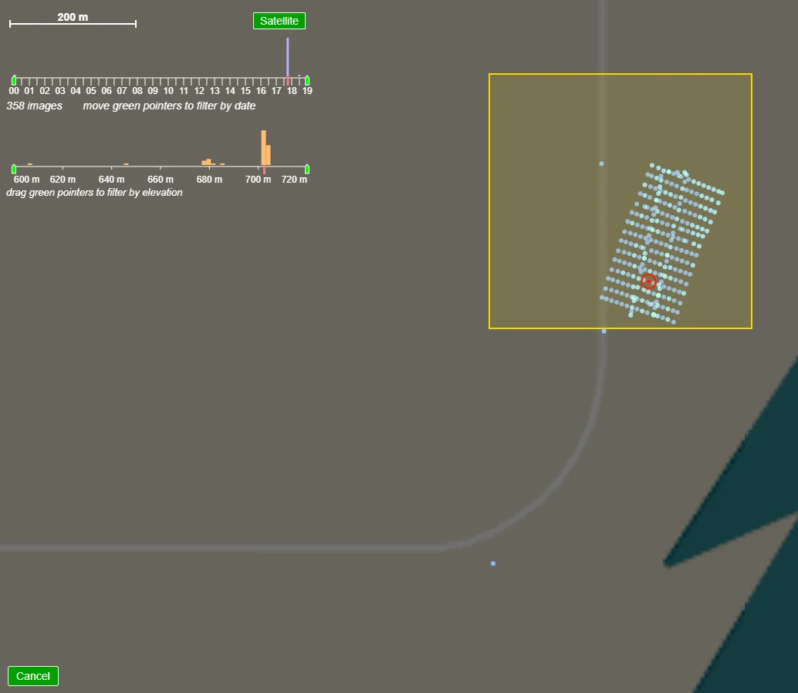

<h1>An HTML / Javascript program for browsing large sets of GPS tagged images from phones or Unmanned Aerial Vehicles, on a map.</h1>

<b>This is my first attempt to clone a repo in GitHub. Thanks to Matthias Wandel for sharing this code.</b>

Matthias Wandel has a video about his version here: <a href="https://youtu.be/D-l51PBAx4I" target="_blank">https://youtu.be/D-l51PBAx4I</a>

You can <a href="https://woodgears.ca/gpspix/index.html" target="_blank"><b>Try it out here</b></a>

I like how phones and drones can show heatmaps of where photos were taken on a map, but my photo collection on my PC encompasses photos from many devices. Matthias wanted to be able to browse photos by location on his PC and so do I, so he created this program. He started by challenging AI (Google Gemini) to write such a program. Over several months he refined it and added features, mostly by requesting specific changes to the code and inspecting and tweaking the resulting code.

The program is intended to be run locally on your computer; all you need is the <code>gps.html</code> and <code>gathergps.html</code> files placed into the root directory of your photo collection.

Scanning thousands of files every time <code>gps.html</code> is opened would take very long. Instead, <code>gps.html</code> loads a file <code>gpstagged.js</code> containing pre-gathered metadata for all images. This file is created by <code>gathergps.html</code>. Due to various security limitations of HTML / JavaScript, <code>gathergps.html</code> needs you to browse to the root of your image tree. After gathering all the metadata, it will create <code>gpstagged.js</code> in your downloads folder. You must then move this file to the root images directory, in the same directory as <code>gps.html</code>.

For his photo collection of 160,000 photos, only 10% have GPS coordinates, and he uses a script <code>gathergps.py</code>, but this Python script assumes the files are organized the way they are on his computer.

<h3>Typical view of GPSpix</h3>

<small>Map data from <a href="https://www.openstreetmap.org" target="_blank">OpenStreetMap</a></small>

The large light blue circle on this view represents several thousand images at a camp. Unfortunately, phones will often use a guess for the Latitude / Longitude coordinates if they don't have a GPS fix when a photo was taken. This guess is often based on the current cell tower and cell sector that the phone is connected to, which can be several kilometers off. The circles towards the top left on the above map are mostly guesses. In his experience, iPhones are much less likely to just use a guess for Lat/Lon.

If you are taking photos and want to make sure they have proper coordinates, you can open your maps app beforehand to ensure the phone gets a fix, as it will try harder to get a fix while in maps. Alternatively, you can tell the phone to navigate somewhere, at which point it will do its best to maintain a GPS fix even with maps running in the background.

Images can be selected by clicking on them with a mouse. Pan and zoom are done by dragging the map or rolling the mouse wheel. You can also pinch in and out on mobile.

Large clusters of images will resolve into smaller clusters and eventually individual images as you zoom in on them.

At the top left of the map view is a scale bar indicating the map scale, plus a button to switch the background  view on Google Maps and back to Satellite.

<h3>Zoomed in on just a few days</h3>

Below the scale bar is a time scale and histogram of when images were taken. You can drag the green sliders on the time scale to limit the images shown to a certain time range. You can also zoom in on the time scale between the markers using the "time zoom in" button. By successively zooming in, you can zoom the time scale to just a few days.

<h3>Altitude Slider</h3>

There is also an altitude slider on the side of the map view. You can use this slider to filter and restrict displayed photos based on their altitude or elevation above sea level. This is especially useful for filtering out high-altitude or low-altitude data points when reviewing aerial or drone imagery.

<h3>Selection Window & Selected Photos</h3>

You can use the selection window feature to draw a bounding box or select a specific area directly on the map. This instantly filters and isolates the displayed photos to only those taken within your drawn boundary, making it easy to examine a specific region in detail.

When you select specific photo dots on the map, they are highlighted to help you review their exact coordinates and metadata. If you press the <b>Delete</b> or <b>Backspace</b> key on your keyboard while items are selected, those items are cleared and hidden from your active view. This allows you to quickly filter out clutter or dismiss specific locations from your session without affecting the actual image files stored on your PC.

